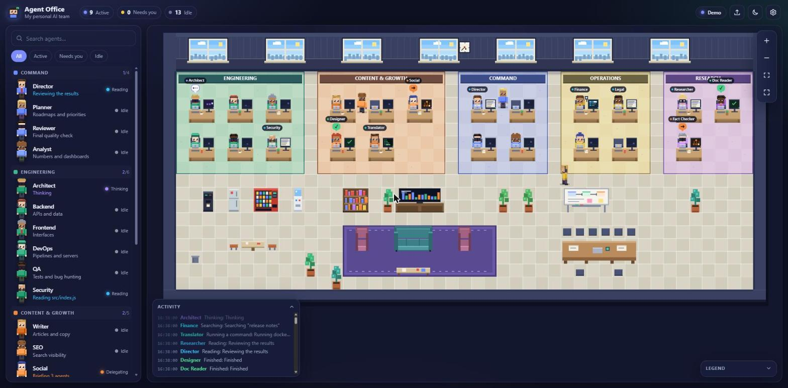
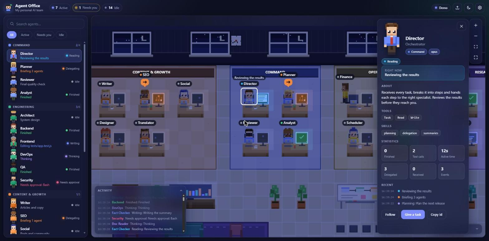
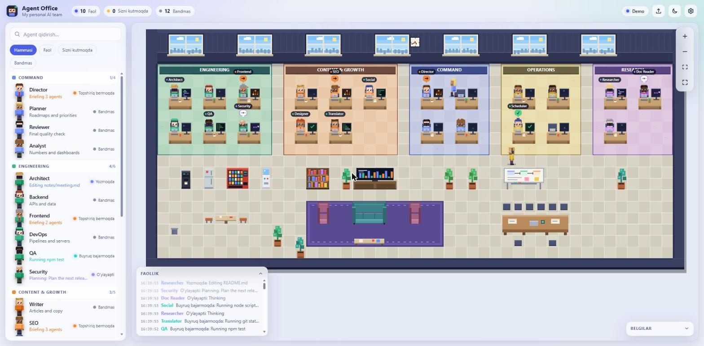
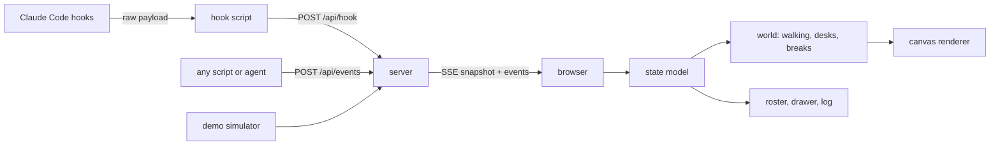

<h1 align="center">Agent Office</h1>

<p align="center"><b>Your personal AI agents, alive in a tiny pixel office.</b><br/>
Every agent is a character with a desk. They walk to work, type, read, search, hand tasks to each other<br/>
and wave at you when they need a decision.</p>

<p align="center">
  <a href="https://github.com/UzRustamBek/agent-office/actions/workflows/ci.yml"></a>
  
  
  
  
</p>

<p align="center">
  <a href="#quick-start">Quick start</a> ·
  <a href="#use-your-own-agents">Your agents</a> ·
  <a href="#connect-claude-code-live">Live mode</a> ·
  <a href="docs/ARCHITECTURE.md">Architecture</a> ·
  <a href="README.uz.md">O‘zbekcha</a>
</p>

<p align="center"></p>

## Why

A list of agents tells you *who exists*. A glance at an office tells you *who is busy, who is stuck and who is waiting for you*. Agent Office turns the agents you already run into a small living place:

- **See state at a glance.** Typing, reading, searching, running a command, thinking, delegating, waiting for you, needs approval, finished, error. Each has its own pose, screen, color and speech bubble.
- **See teamwork.** When one agent hands a task to another, a little envelope flies across the office.
- **Know when to step in.** The "Needs you" counter pulses, the character raises a hand, and an optional chime plays.
- **It is yours.** Departments, names, roles, looks and tools come from a plain JSON file, or are imported straight from your Claude Code agent folders.

No build step, no framework, **zero dependencies**. Node 20+ and a browser.

## Quick start

```bash
git clone https://github.com/UzRustamBek/agent-office.git
cd agent-office
node bin/agent-office.js start --demo --open
```

That serves the office at `http://127.0.0.1:4317` with simulated agents so you can see everything working. Press `/` to search, click an agent for details, scroll to zoom, drag to pan, double-click to follow.

> The hosted demo (GitHub Pages) runs the same simulation entirely in the browser: no server needed.

## Use your own agents

### Option A: import your Claude Code agents

```bash
node bin/agent-office.js import                 # ~/.claude/agents and ./.claude/agents
node bin/agent-office.js import D:/my/agents    # or any folder (subfolders become departments)
node bin/agent-office.js start
```

`import` reads only the front matter (`name`, `description`, `model`, `tools`, `color`) of your `*.md` agent files and writes `agents.local.json`. Folder names become departments, the system prompt body is **never** copied, and the file is git-ignored.

### Option B: write a roster

```json
{
  "office": { "title": "My Studio", "mainAgent": "director" },
  "departments": [
    { "id": "build", "name": "Build", "color": "#3fb68b" }
  ],
  "agents": [
    {
      "id": "director",
      "name": "Director",
      "role": "Orchestrator",
      "department": "build",
      "model": "opus",
      "tools": ["Task", "Read"],
      "look": { "hair": "short", "accessory": "glasses" }
    }
  ]
}
```

Save it as `agents.json` (or `agents.local.json`) next to where you run the command, or pass `--agents my.json`. The file is watched: edit it and the office updates live. Full reference: [docs/AGENTS-FORMAT.md](docs/AGENTS-FORMAT.md). Ready-made samples live in [examples/](examples) (`minimal.json`, and `uz-team.json` with Uzbek names). In the hosted demo you can also **drop a roster file onto the page** to see your team instantly.

## Connect Claude Code (live)

Agent Office listens to [Claude Code hooks](https://docs.claude.com/en/docs/claude-code/hooks). The hook script is tiny, silent and never blocks Claude.

```bash
node bin/agent-office.js start                          # terminal 1
node bin/agent-office.js hooks install --scope user     # shows what will change (dry run)
node bin/agent-office.js hooks install --scope user --write
```

Restart your Claude Code sessions, then work as usual. The main session appears as your `mainAgent`; when it calls a subagent (the `Task` tool) that agent walks to its desk and gets to work, and an envelope flies from the delegator to it.

Pin a terminal to a specific agent:

```bash
AGENT_OFFICE_AGENT=backend claude
```

Details, the full event table and troubleshooting: [docs/HOOKS.md](docs/HOOKS.md).

### Any other agent or script

Anything that can send an HTTP request can have a desk:

```bash
node bin/agent-office.js emit --agent writer --status typing --activity "Drafting the newsletter"
node bin/agent-office.js emit --delegate director:writer --task "Newsletter"
```

or `POST /api/events` with the bearer token printed in `~/.agent-office/servers/`. The protocol is five fields; see [docs/ARCHITECTURE.md](docs/ARCHITECTURE.md#event-protocol).

## What you get

| | |
|---|---|
| **Office** | Departments become carpeted zones with a desk per agent, plus a lounge, pantry and meeting room. The layout is generated from your roster (1 to 120 agents). |
| **Characters** | Drawn in code (no image files). Six skin tones, eight hairstyles, accessories, team-colored shirts, walk cycles in four directions, and a pose for every state. |
| **Life** | Idle agents take coffee and sofa breaks, then walk back when work arrives. Path-finding with turn penalties keeps movement natural. |
| **Screens** | Each monitor shows what its agent is doing: scrolling code, a terminal, a document, search results, a delegation graph, a "?" or "!" alert. |
| **Roster panel** | Search, filter (active / needs you / idle), department groups, live activity text. |
| **Details drawer** | Role, model, tools, skills, counters, active time, recent history, follow camera. |
| **Activity log** | A running feed of status changes and delegations. |
| **Day and night** | Lighting follows your local time or a switch; screens glow after dark. |
| **Themes and languages** | Dark and light, English, Oʻzbekcha and Русский. |
| **Accessible** | Keyboard shortcuts, reduced-motion mode, readable text rendered outside the canvas. |
| **Mobile** | Pinch to zoom, drag to pan, slide-over roster. |

Keyboard: `/` search · `f` fit · `+` `-` zoom · `l` log · `t` theme · `Esc` close.

## Gallery

<table>
  <tr>
    <td width="50%"><br/><sub><b>Night mode</b>: monitors glow, click an agent for its drawer: tools, skills, counters, history.</sub></td>
    <td width="50%"><br/><sub><b>Light theme, Oʻzbekcha UI</b>: the same office, English / Uzbek / Russian.</sub></td>
  </tr>
</table>

## Privacy and security

- **Local only.** The server binds to `127.0.0.1` by default. Nothing is sent anywhere.
- **Small hook payloads.** The hook forwards only tool name, a file *basename*, a short command description and ids. File contents, tool results, transcript paths and full paths never leave Claude Code.
- **Prompts are hidden** unless you start the server with `--share-prompts`.
- **Writes need a token.** `POST` endpoints require a random bearer token, `application/json`, a size limit and a `Host` check against DNS rebinding. The page itself ships a strict Content-Security-Policy and never writes HTML strings.
- **Hooks change only what you approve.** `hooks install` is a dry run until you add `--write`, backs up your settings first, and `uninstall` removes only its own entries.

See [SECURITY.md](SECURITY.md).

## CLI

```text
agent-office start     [--agents file] [--port n] [--host addr] [--demo] [--demo-speed n] [--share-prompts] [--open]
agent-office import    [dir...] [--out file] [--main name] [--title text] [--dry-run]
agent-office hooks     print | install | uninstall | status  [--scope user|project|local] [--all] [--agent id] [--write]
agent-office emit      --agent id --status <status> [--activity text] | --delegate from:to [--task text]
agent-office doctor
```

## How it works



The state model and the layout generator are pure modules shared by the server, the browser and the tests. Read the [architecture notes](docs/ARCHITECTURE.md).

## Project layout

```text
bin/        CLI entry point
server/     HTTP + SSE server, hook mapping, importer, hook installer
hook/       the tiny Claude Code hook script
web/        the app: core/ (pure logic), office/ (art + world), ui/, sim/
test/       node:test suites (core, layout, server, hooks, importer, simulator)
docs/       architecture, hooks, roster format, customizing
```

## Development

```bash
npm test         # unit and integration tests (no install needed)
npm run check    # syntax, imports, CSP rules, docs links
npm run demo
```

There is nothing to install: `package.json` has no dependencies. See [CONTRIBUTING.md](CONTRIBUTING.md).

## Roadmap

- Transcript fallback for sessions started without hooks
- More furniture packs and an in-app layout editor
- Session recording and replay
- Adapters for other agent CLIs

## License

[MIT](LICENSE). All code and all pixel art in this repository is original and generated procedurally.
