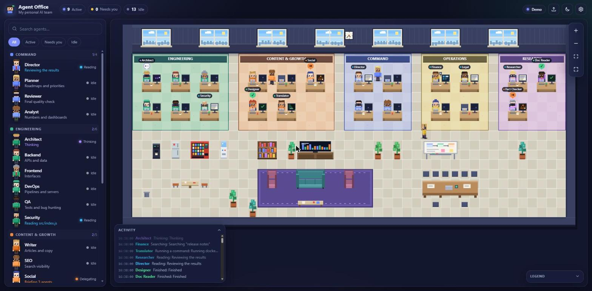

<h1 align="center">Agent Office</h1>

<p align="center"><b>Shaxsiy AI agentlaringiz, kichik piksel-ofisda jonli.</b><br/>
Har bir agent, o‘z stoli bor personaj. Ular ishga yuradi, yozadi, o‘qiydi, qidiradi,<br/>
bir-biriga vazifa uzatadi va qaror kerak bo‘lganda sizga qo‘l ko‘taradi.</p>

<p align="center">
  <a href="README.md">English</a> ·
  <a href="#tez-boshlash">Tez boshlash</a> ·
  <a href="#oz-agentlaringizni-qoshing">O‘z agentlaringiz</a> ·
  <a href="#claude-code-ga-ulash-jonli-rejim">Jonli rejim</a> ·
  <a href="docs/ARCHITECTURE.md">Arxitektura</a>
</p>

<p align="center"></p>

## Nima uchun

Agentlar ro‘yxati *kim borligini* aytadi. Ofisga bir qarash esa *kim band, kim qotib qolgan va kim sizni kutayotganini* ko‘rsatadi. Agent Office siz allaqachon ishlatayotgan agentlarni kichik jonli joyga aylantiradi:

- **Holatni bir qarashda ko‘ring.** Yozmoqda, o‘qimoqda, qidirmoqda, buyruq bajarmoqda, o‘ylayapti, topshiriq bermoqda, sizni kutmoqda, ruxsat so‘ramoqda, tugatdi, xatolik. Har birining o‘z holati, ekrani, rangi va pufakchasi bor.
- **Jamoaviy ishni ko‘ring.** Bir agent boshqasiga vazifa bersa, konvert tashkilotingizning hisobot chiziqlari bo‘ylab uchib o‘tadi.
- **Kim kimga bo‘ysunishini ko‘ring.** Rahbar eng tepada, bo‘limlar uning ostida, har bir bo‘ysunish darajasi esa stollarning alohida qatorida.
- **Majlisni kuzating.** Claude Code’da asosiy agentga vazifa bersangiz, u avval jamoasini majlis stoliga chaqiradi, ishni doskada taqsimlaydi, keyin hamma o‘z stoliga qaytadi.
- **Qachon aralashishni biling.** «Sizni kutmoqda» hisoblagichi miltillaydi, personaj qo‘lini ko‘taradi, xohlasangiz signal ham chalinadi.
- **Hammasi sizniki.** Bo‘limlar, nomlar, rollar, ko‘rinish va asboblar oddiy JSON fayldan olinadi yoki to‘g‘ridan-to‘g‘ri Claude Code agent papkalaringizdan import qilinadi.

Build bosqichi yo‘q, framework yo‘q, **hech qanday bog‘liqlik yo‘q**. Faqat Node 20+ va brauzer.

## Tez boshlash

```bash
git clone https://github.com/UzRustamBek/agent-office.git
cd agent-office
node bin/agent-office.js start --demo --open
```

Bu `http://127.0.0.1:4317` manzilida ofisni simulyatsiya qilingan agentlar bilan ochadi. `/` qidiruv, agentni bosing: tafsilotlar, g‘ildirak: kattalashtirish, sudrash: surish, ikki marta bosish: kuzatish.

> GitHub Pages dagi demo xuddi shu simulyatsiyani butunlay brauzerda ishlatadi, server shart emas.

## O‘z agentlaringizni qo‘shing

### A usul: Claude Code agentlaringizni import qilish

```bash
node bin/agent-office.js import                 # ~/.claude/agents va ./.claude/agents
node bin/agent-office.js import D:/mening/agentlarim   # yoki istalgan papka (ichki papkalar bo‘lim bo‘ladi)
node bin/agent-office.js start
```

`import` faqat `*.md` agent fayllaringizning front matter qismini (`name`, `description`, `model`, `tools`, `color`) o‘qiydi va `agents.local.json` yozadi. Papka nomlari bo‘limga aylanadi, tizim promptining matni **hech qachon** ko‘chirilmaydi, fayl esa git’ga kirmaydi.

### B usul: roster yozish

```json
{
  "office": { "title": "Mening studiyam", "mainAgent": "direktor" },
  "departments": [
    { "id": "ish", "name": "Ishlab chiqarish", "color": "#3fb68b" }
  ],
  "agents": [
    {
      "id": "direktor",
      "name": "Direktor",
      "role": "Boshqaruvchi",
      "department": "ish",
      "reportsTo": null,
      "model": "opus",
      "tools": ["Task", "Read"],
      "look": { "hair": "short", "accessory": "glasses" }
    }
  ]
}
```

Tayyor o‘zbekcha namuna: `node bin/agent-office.js start --demo --agents examples/uz-team.json`.

Uni `agents.json` (yoki `agents.local.json`) nomi bilan buyruq ishga tushirilgan papkaga saqlang yoki `--agents fayl.json` bering. Fayl kuzatiladi: tahrirlasangiz ofis o‘sha zahoti yangilanadi. `reportsTo` tashkiliy sxemani quradi (yozilmasa o‘zi aniqlanadi). To‘liq ma’lumot: [docs/AGENTS-FORMAT.md](docs/AGENTS-FORMAT.md). Hosting qilingan demoda roster faylini sahifaga **tashlab** jamoangizni darhol ko‘rishingiz ham mumkin.

## Claude Code ga ulash (jonli rejim)

Agent Office [Claude Code hooklarini](https://docs.claude.com/en/docs/claude-code/hooks) tinglaydi. Hook skripti juda kichik, jim ishlaydi va Claude’ni hech qachon to‘xtatmaydi.

```bash
node bin/agent-office.js start                          # 1-terminal
node bin/agent-office.js hooks install --scope user     # nima o‘zgarishini ko‘rsatadi (sinov)
node bin/agent-office.js hooks install --scope user --write
```

Claude Code sessiyalarini qayta ishga tushiring va odatdagidek ishlang. Asosiy sessiya `mainAgent` sifatida ko‘rinadi. U subagentni chaqirsa (`Task` vositasi), o‘sha agent stoliga borib ish boshlaydi, topshiruvchidan unga konvert uchadi.

Terminalni aniq bir agentga biriktirish:

```bash
AGENT_OFFICE_AGENT=backend claude
```

Tafsilotlar, hodisalar jadvali va nosozliklarni tuzatish: [docs/HOOKS.md](docs/HOOKS.md).

### Boshqa agent yoki skriptlar

HTTP so‘rov yubora oladigan har qanday narsa o‘z stoliga ega bo‘lishi mumkin:

```bash
node bin/agent-office.js emit --agent writer --status typing --activity "Axborotnomani yozmoqda"
node bin/agent-office.js emit --delegate director:writer --task "Axborotnoma"
```

Protokol: [docs/ARCHITECTURE.md](docs/ARCHITECTURE.md#event-protocol).

### Kompyuter yoqilganda o‘zi ishga tushsin

```bash
node bin/agent-office.js autostart install --write
```

Faqat bitta kichik fayl yoziladi (Windows: Startup papkasida yashirin skript). `autostart uninstall --write` uni olib tashlaydi. Batafsil: [docs/HOOKS.md](docs/HOOKS.md).

## Nimalar bor

| | |
|---|---|
| **Ofis** | Bo‘limlar gilamli zonalarga aylanadi, har agentga bitta stol; yana dam olish xonasi, oshxona va majlis xonasi. Maket rosterdan avtomatik quriladi (1 dan 120 gacha agent). |
| **Ierarxiya** | Yurish mumkin bo‘lgan tashkiliy sxema: tepada rahbar, so‘ng bo‘lim boshliqlari, so‘ng ishni bajaruvchilar; ular hisobot chiziqlari bilan bog‘langan. Rahbar va boshliqlarni tilla va po‘lat rangli stol yorlig‘i ajratib turadi. [Ierarxiya](docs/AGENTS-FORMAT.md#hierarchy). |
| **Personajlar** | To‘liq kod bilan chizilgan (rasm fayllari yo‘q). 6 teri rangi, 8 soch turmagi, aksessuarlar, jamoa rangidagi ko‘ylak, to‘rt yo‘nalishda yurish va har holat uchun alohida poza. |
| **Majlis** | Yangi vazifa majlis bilan boshlanadi: rahbar doska oldida, jamoa stol atrofida, kun tartibiga stikerlar qo‘shiladi, vazifa kartochkalari tarqatiladi, gapiruvchi pufakchasi navbat bilan o‘tadi, banner vaqtni sanaydi. So‘ng vazifalar konvert bo‘lib uchadi. |
| **Hayot** | Ishlayotgan agentlar stolida o‘tiradi. Band bo‘lmaganlar kofe yoki divanga borishi mumkin (standart bo‘yicha kamdan-kam; *Tanaffuslar* sozlamasi bilan hech qachon yoki tez-tez qilish mumkin), ish kelsa qaytadi. |
| **Ekranlar** | Har monitor agent nima qilayotganini ko‘rsatadi: kod, terminal, hujjat, qidiruv natijalari, topshiriq grafi, «?» yoki «!» belgisi. |
| **Ro‘yxat paneli** | Qidiruv, filtr (faol / sizni kutmoqda / bo‘sh), bo‘limlar bo‘yicha guruhlar, jonli faollik matni. |
| **Tafsilot paneli** | Rol, model, asboblar, ko‘nikmalar, hisoblagichlar, faol vaqt, oxirgi harakatlar, kuzatuv kamerasi. |
| **Kun va tun** | Yoritish mahalliy vaqtga qarab yoki qo‘lda; qorong‘uda ekranlar yaltirab turadi. |
| **Mavzu va til** | Qorong‘i va yorug‘ mavzu; English, Oʻzbekcha, Русский. |
| **Qulaylik** | Klaviatura yorliqlari, kam harakat rejimi, kanvasdan tashqarida chiziladigan o‘qiladigan matn. |
| **Telefon** | Ikki barmoq bilan kattalashtirish, surish, yon panelli ro‘yxat. |

Klaviatura: `/` qidiruv · `f` moslash · `+` `-` masshtab · `l` jurnal · `t` mavzu · `Esc` yopish.

## Maxfiylik va xavfsizlik

- **Faqat lokal.** Server odatda `127.0.0.1` da ishlaydi. Hech narsa tashqariga yuborilmaydi.
- **Kichik hook ma’lumotlari.** Hookning o‘zi har bir ma’lumotni asbob nomi, fayl *nomi* (papkasiz), buyruqning dasturi (argumentlarsiz), qisqa tavsiflar va identifikatorlargacha qisqartiradi. Fayl mazmuni, asbob natijalari, URL, transkript yo‘llari va promptlar Claude Code’dan chiqmaydi (promptlar faqat `AGENT_OFFICE_SHARE_PROMPTS=1` bilan).
- **Prompt matnlari yashirin**, faqat `--share-prompts` bilan ko‘rinadi.
- **Yozish uchun token kerak.** `POST` so‘rovlar tasodifiy bearer token, `application/json`, hajm chegarasi va DNS rebinding’ga qarshi `Host` tekshiruvini talab qiladi. Sahifa qat’iy Content-Security-Policy bilan keladi.
- **Hooklar faqat siz tasdiqlaganni o‘zgartiradi.** `hooks install` siz `--write` qo‘shmaguncha sinov rejimida; avval sozlamalaringizdan zaxira nusxa oladi; `uninstall` faqat o‘zining yozuvlarini olib tashlaydi.

[SECURITY.md](SECURITY.md) ga qarang.

## Ishlab chiqish

```bash
npm test         # birlik va integratsiya testlari (o‘rnatish shart emas)
npm run check    # sintaksis, importlar, CSP qoidalari, hujjat havolalari
npm run demo
```

O‘rnatiladigan hech narsa yo‘q: `package.json` da bog‘liqliklar yo‘q. [CONTRIBUTING.md](CONTRIBUTING.md) ga qarang.

## Litsenziya

[MIT](LICENSE). Bu repozitoriyadagi barcha kod va barcha piksel-art original bo‘lib, protsedura orqali yaratilgan.
